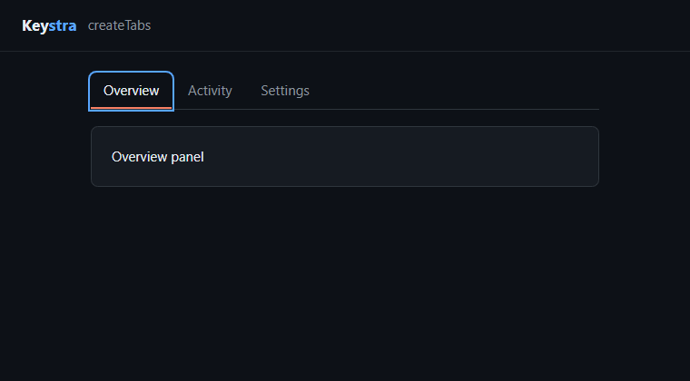

# Keystra

Keyboard navigation, focus and selection for any DOM UI.

- Works with vanilla JS, TypeScript and any DOM-based framework.
- Arrow keys, Home/End, typeahead, shortcuts and key sequences.
- Roving tabindex, focus restore, and single, multiple or range selection.
- Ready-made tabs, menus, dropdowns, lists, grids, trees and command palettes.
- Skips disabled and hidden items, and keeps up with DOM changes.
- No dependencies, and no UI or styling of its own.



## Install

```bash
npm i keystra
```

## Quick start

```html
<div id="actions" aria-label="Actions">
  <button data-keystra-item>Copy</button>
  <button data-keystra-item>Move</button>
  <button data-keystra-item disabled>Delete</button>
</div>
```

```ts
import { createKeystra } from 'keystra';

const nav = createKeystra({
  container: '#actions',
  loop: true,
  onSelect: (element) => console.log('activate', element),
});

nav.focusFirst();

// When the UI is removed:
nav.destroy();
```

Arrow keys now move through the buttons and skip the disabled one, Tab leaves the group in one stop, and Enter calls `onSelect`.

## Patterns

```ts
import { createTabs } from 'keystra';

const tabs = createTabs({
  container: '#tabs',
  items: '[role="tab"]',
  panels: '[role="tabpanel"]',
});
```

Also available: `createMenu`, `createDropdown`, `createList`, `createGrid`, `createTree`, `createCommandPalette` and `createRovingFocus`. See [Patterns](docs/patterns.md).

## Shortcuts

```ts
import { createKeyBinding } from 'keystra';

const palette = createKeyBinding('Ctrl+K', () => openPalette());
```

## Docs

- [API](docs/api.md): options, methods, keys, selection and lifecycle.
- [Patterns](docs/patterns.md): each ready-made widget.
- [Frameworks](docs/frameworks.md): React, Vue, Svelte and Angular.
- [Accessibility](docs/accessibility.md): what Keystra does and what stays yours, plus browser support.
- [Performance](docs/performance.md): bundle size and large lists.

## License

MIT
